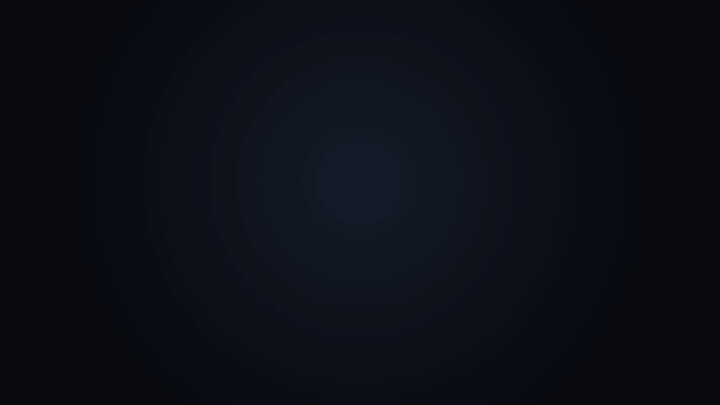

<div align="center">


# Frameless

**Screenshots, annotations and screen recordings for macOS, built light and native.**

[](https://github.com/gian-gg/frameless/releases/latest)


[](LICENSE)

[Download](https://github.com/gian-gg/frameless/releases/latest) ·
[Features](#features) ·
[Install](#install) ·
[Build from source](#build-from-source)



</div>

Pick a display, an area or a window, mark it up, then copy, save, pin or record it. Scroll through a long page to
capture it as one tall image.

Capture and encoding are done by macOS itself, and Frameless uses no CPU while idle. Start from the menu bar or a
shortcut.

## Features

### Capture

- **Anything on screen:** a whole display, a dragged area, or a single window
- **Adjustable:** resize or move the selection first, with a live pixel-size tag
- **Exact windows:** captured at the window's own size, without the shadow padding
- **Retina-aware:** full pixel resolution, opening at its on-screen size
- **Your choice of output:** copy, save as PNG, or pin on screen

### Annotate

- **Shapes:** rectangle, line, arrow and freehand; hold <kbd>⇧</kbd> for squares and 45° lines
- **Highlight:** keeps an area bright and darkens the rest
- **Pixelate:** hides an area for good, rebuilt from the image's own pixels
- **Steps:** numbered markers that count up as you place them
- **Text:** typed in place
- **Style:** six colours and three thicknesses, remembered between screenshots
- **Edit:** select a mark to move, restyle or delete it; undo and redo everything
- **Keyboard-friendly:** every tool has a one-key shortcut, shown in its tooltip

### Scroll

- **Scrolling screenshots:** pick an area or a window, press <kbd>⌘L</kbd>, then scroll as usual
- **Live preview:** the stitched image grows beside the area as you go
- **Keeps up with the page:** sticky headers are kept once, and a playing video or a loading image rarely throws it off
- **Your choice of output:** copy, save or pin the result once you're done
- **Best fit:** drag over just the part that scrolls, since anything still inside the area repeats

### Pin

- **Float it:** keep a screenshot above your windows while you work
- **Move and resize:** drag it anywhere, scroll to zoom, <kbd>⌥</kbd>-scroll to fade
- **Right-click:** copy, save, zoom, fade or close; close all pins from the menu

### Record

- **Anything on screen:** a display, an area or a single window
- **Audio:** system sound and microphone
- **Quality:** H.264 or HEVC, Original / 1440p / 1080p / 720p, 30 or 60 fps
- **Stop from the menu bar:** the icon turns red while recording; click it to save or discard
- **Never lost:** a recording macOS ends on its own (window closed, display unplugged) is still saved

### Everywhere

- **Shortcuts:** <kbd>⇧⌘2</kbd> for a screenshot and <kbd>⇧⌘6</kbd> to record, changeable in Preferences
- **Save folders:** choose where screenshots and recordings go
- **Feedback:** macOS capture sounds and a floating thumbnail; click to open, drag to share
- **Liquid Glass:** on macOS 26, with frosted glass on earlier versions

## Install

1. Download `Frameless.dmg` from the [latest release](https://github.com/gian-gg/frameless/releases/latest).
2. Open it and drag **Frameless** into **Applications**.
3. Open **Frameless**. The app isn't notarised, so the first time macOS says it can't check it: open **System Settings →
   Privacy & Security**, scroll down and click **Open Anyway**.
4. Allow **Screen Recording** when asked, and **Microphone** if you want to record your voice.

Requires macOS 15 or later.

## Build from source

You need macOS 15 or later and Swift 6 (Xcode or the Command Line Tools).

```sh
git clone https://github.com/gian-gg/frameless.git
cd frameless
make run
```

`make app` builds `build/Frameless.app` without opening it, and `make check` runs the linters and tests (it needs
SwiftLint, from `brew install swiftlint`).

## Contributing

Issues and pull requests are welcome. Please run `make check` before opening a pull request.

## License

[MIT](LICENSE)
