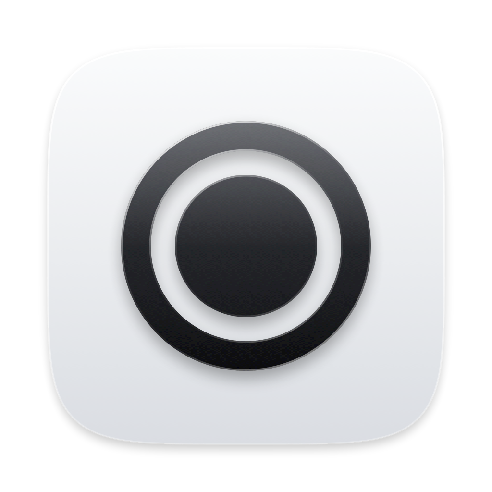

# Frameless

A lightweight screenshot and screen recording tool for macOS that lives in the menu bar.

Pick a display, an area or a window, adjust the selection, then copy, save or record. Capture and encoding are done by macOS
itself, so Frameless stays idle while you record. Requires macOS 15 or later.

## Features

**Screenshots**

- Capture a whole display, a dragged area, or a single window
- Resize or move the selection before capturing, with a live pixel-size tag
- Copy to the clipboard or save as PNG
- Window shots come out at the window's exact size, without the shadow padding
- Retina-aware: full pixel resolution, opening at its on-screen size

**Recording**

- Record a display, an area or a single window, adjusting the selection first
- System audio and microphone
- H.264 or HEVC, Original / 1440p / 1080p / 720p, 30 or 60 fps
- The menu bar icon turns red while recording; click it to stop and save or discard
- A recording that macOS ends on its own (window closed, display unplugged) is still saved

**Everywhere**

- Customisable global shortcuts: <kbd>⇧⌘2</kbd> for a screenshot and <kbd>⇧⌘6</kbd> to start or stop a recording by default
- macOS capture sounds and a floating thumbnail after each capture: click to open, drag to share
- Liquid Glass interface on macOS 26, frosted glass on earlier versions
- No windows, no Dock icon: everything is in the menu bar

## License

[MIT](LICENSE)
